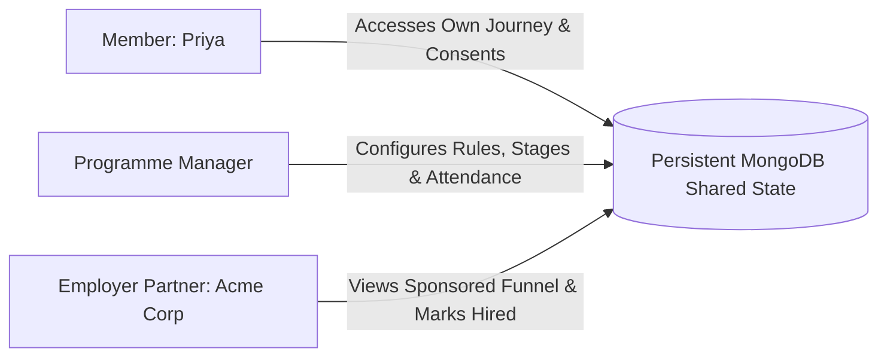

# HerJourney — Comprehensive Product & Engineering Architecture Write-Up

> **Author:** Candidate for Junior Full-Stack Developer  
> **Product Vision:** *"One identity. Every chapter of your career."*  
> **Target Demography:** Women's Lifelong Career Community in India (20–30 Year Horizon)

---

## 1. Problem Understanding & Business Context

Nonprofit organizations, skilling foundations, and women’s career networks across India are attempting to guide women through long-term transitions: from college student, to first corporate job, to mid-career advancement, through parental/caregiving career breaks, back into the workforce (returnships), and eventually into executive leadership and mentorship.

However, organizations currently administer these programs with a fragmented collage of ad-hoc tools:
1. **Google Forms & Excel Spreadsheets:** Every new hackathon, bootcamp, or returnship cohort requires women to fill out a brand-new form from scratch.
2. **WhatsApp Broadcast Groups:** Unsegmented messages blast thousands of women without understanding life stages, skills, or communication consent.
3. **Siloed Databases:** A woman who excelled in a 2021 hackathon is an anonymous stranger when she seeks a returnship in 2026.
4. **Anecdotal Outcome Tracking:** Placement outcomes and retention metrics are lost within weeks of program completion, leaving corporate sponsors and philanthropic funders with weak impact data.

### The Core Failure Mode: Identity Fragmentation
This creates duplicate identities, broken career histories, donor reporting blind spots, and severe user fatigue. A woman navigating a career reentry already faces significant confidence hurdles; requiring her to repeatedly justify her foundational credentials across disconnected portals exacerbates drop-off rates.

---

## 2. Product Approach & Strategic Architecture

### The Foundational Tenet:
$$\text{ONE WOMAN} \longrightarrow \text{ONE IDENTITY} \longrightarrow \text{COMPLETE CAREER JOURNEY}$$

Instead of building a generic CRM or an unfocused social network, **HerJourney** establishes a single persistent career record that tracks a woman’s entire professional arc.

### Key Strategic Product Decision
In this prototype, we made the deliberate product choice to focus on:
$$\mathbf{One\ Identity} + \mathbf{Programme\ Workflow} + \mathbf{Shared\ Live\ State} + \mathbf{Longitudinal\ Outcome\ Tracking}$$

We intentionally prioritized these four interdependent systems over building an exhaustive suite of social messaging features. A community platform without identity persistence and verified outcome integrity quickly degenerates into another noisy spreadsheet; conversely, solidifying identity, workflow, and outcome mechanics creates an unshakeable foundation that easily accommodates future community enhancements.

---

## 3. User Roles & Access Architecture

HerJourney implements strict **Role-Based Access Control (RBAC)** across three primary stakeholders:



| User Role | Persona Representation | Primary Capabilities | Permissions & Boundaries |
| :--- | :--- | :--- | :--- |
| **Member** | **Priya Sharma** (34, Bengaluru, Returner) | • View & edit permitted profile fields<br>• Access personal career journey timeline<br>• 1-Click register with profile reuse<br>• View session attendance & credentials<br>• Receive deterministic opportunities with *"Why am I seeing this?"*<br>• Submit 3-month retention check-ins | **Strict Privacy Boundary:** Can **never** access another member's private data or records. Full contact information unmasked only to self. |
| **Programme Manager** | **Maya Rao** (Programme Director) | • Create new programmes with custom stages<br>• Configure deterministic eligibility rules<br>• Scan ecosystem for eligible candidates<br>• Verify consent prior to invitations<br>• Move candidates through stages<br>• Track workshop attendance percentages<br>• Issue permanent verifiable certificates<br>• Resolve ambiguous duplicates in Review Queue | **Operational Boundary:** Contact details masked (`p***@gmail.com`). Access limited to organizational governance. |
| **Employer Partner** | **Acme Corp Talent Partner** | • View sponsored returnship funnel<br>• Review shortlisted returner candidates<br>• One-click mark candidates as `Hired`<br>• Audit self-reported 3-month retention outcomes into `Verified` state | **Strict Commercial Isolation:** Can **only** see programmes sponsored by Acme Corp. Zero access to other partner pipelines. Contact details masked. |

---

## 4. Complete Data Model (MongoDB / Mongoose)

The platform models relationships using standard MongoDB ObjectIds and indexed schemas:

```
┌───────────────────────────────────────────────────────────┐
│                          MEMBER                           │
├───────────────────────────────────────────────────────────┤
│ _id: ObjectId                                             │
│ name: String                                              │
│ email: String (Unique, Indexed)                           │
│ phone: String (Unique, Indexed)                           │
│ age: Number, city: String                                 │
│ careerStage: 'Student'|'Returner'|'Early Career'|'Leader' │
│ previousRoles: [{ title, company, duration, years }]      │
│ yearsOfExperience: Number                                 │
│ skills: [String]                                          │
│ education: String, careerGoal: String                     │
│ careerBreakMonths: Number                                 │
│ communities: [ObjectId -> Community]                     │
│ consent: { programmeInvitations, partnerSharing, date }   │
│ profileCompletion: Number                                 │
└───────────────────────────────────────────────────────────┘
                           │
             ┌─────────────┴─────────────┐
             ▼                           ▼
┌─────────────────────────┐ ┌─────────────────────────┐
│       APPLICATION       │ │       CERTIFICATE       │
├─────────────────────────┤ ├─────────────────────────┤
│ _id: ObjectId           │ │ _id: ObjectId           │
│ memberId: ObjectId      │ │ memberId: ObjectId      │
│ programmeId: ObjectId   │ │ programmeId: ObjectId   │
│ currentStage: String    │ │ certificateNumber: Str  │
│ status: 'In Progress'.. │ │ skillsEndorsed: [Str]   │
│ attendance: [{ session, │ │ issueDate: Date         │
│               present}] │ │ status: 'Issued'        │
│ completedAt, placedAt   │ └─────────────────────────┘
└─────────────────────────┘
             │                           ▲
             ▼                           │
┌─────────────────────────┐ ┌────────────┴────────────┐
│         OUTCOME         │ │        PROGRAMME        │
├─────────────────────────┤ ├─────────────────────────┤
│ _id: ObjectId           │ │ _id: ObjectId           │
│ memberId: ObjectId      │ │ name: 'Returnship 2026' │
│ programmeId: ObjectId   │ │ partnerId: ObjectId     │
│ type: '3-Month Checkin' │ │ eligibilityRules: {     │
│ response: 'Yes'|'No'..  │ │   minCareerBreakMonths, │
│ verified: Boolean       │ │   requiredSkills: [] }  │
│ verifiedBy: String      │ │ stages: ['Applied'...]  │
└─────────────────────────┘ └─────────────────────────┘
```

---

## 5. Technology Stack & Architectural Justifications

| Layer | Technology | Engineering Rationale |
| :--- | :--- | :--- |
| **Frontend Framework** | **React 18 + Vite** | Instant HMR, sub-15 second compilation, optimal bundle sizes, and robust component reusability. |
| **CSS & Design Engine** | **Tailwind CSS** | Strictly adheres to the custom palette (Deep Plum, Rose Mauve, Soft Coral, Warm Ivory) with responsive breakpoints (375px, 768px, 1024px+). |
| **Navigation & State** | **React Router v6 + Context** | Client-side routing with clean role-switching contexts (`AuthContext`, `LowDataContext`). |
| **Icons & Charts** | **Lucide React + Recharts** | Lightweight vector icons; interactive SVG conversion funnel visualization for manager and partner dashboards. |
| **Backend API** | **Node.js + Express** | High-throughput asynchronous REST APIs with modular routing, centralized error handlers, and RBAC middleware. |
| **Database & ODM** | **MongoDB + Mongoose** | Flexible JSON-document modeling ideal for evolving career histories, multi-cohort applications, and verification credentials. |
| **Zero-Friction Fallback** | **MongoDB Memory Server** | Automatically launches an embedded MongoDB engine if no external Atlas URI is provided. Evaluators can clone and run without installing MongoDB! |

---

## 6. One Identity & Duplicate Detection Engine

### Exact Match & Profile Reuse:
When a member registers for a new programme, the system scans for an exact normalized phone (`normalizePhone`) or email:
1. If an exact match is discovered:
   - **Do NOT create another record.**
   - Return `EXACT_MATCH` with message: *"Welcome back, Priya. We found your existing profile and reused the information we already have."*
   - Pre-fill existing data (experience, break duration, skills) and request **only missing fields**.

### Ambiguous Match & Review Queue (Anti-Silent-Merge Policy):
If an incoming registration shares a phone number with an existing member but has a different email address (e.g., Priya's personal Gmail vs. her alumni email):
- **Never silently overwrite or merge records.**
- An automatic merge could result in catastrophic data cross-contamination or unauthorized account takeover.
- The system generates a `POSSIBLE_MATCH` flag, computes a confidence score (e.g., 78%), and routes the record to the manager's **Review Queue**.
- A human administrator inspects the side-by-side comparison and explicitly selects `Merge Profile` or `Create Separate Member`.

---

## 7. Deterministic Business Rules (No Black-Box AI)

In compliance with the assignment specification, **no LLMs or AI APIs (OpenAI, Gemini, LangChain)** are embedded in the runtime product. All calculations are 100% explainable, deterministic, and auditable:

### 1. Programme Eligibility Engine (`eligibilityEngine.js`)
```javascript
// Example: Returnship Cohort Logic
IF member.careerBreakMonths >= programme.minCareerBreakMonths (e.g. 12)
AND member.skills contains ANY OF programme.requiredSkills (Product OR Analytics)
AND member.careerStage IN programme.allowedLifeStages
THEN Eligible = true
```
Output includes an explainable breakdown:
- `✓ Career break is 36 months (meets requirement of >= 12 months)`
- `✓ Matched skill(s): Product Management, Analytics`

### 2. Opportunity Recommendation Engine (`opportunityEngine.js`)
Calculates a relevance score (0–100%) based on career stage matching (+40), skill intersection (+40), and career break duration (+20). Every recommended card includes a **"Why am I seeing this?"** modal explaining the exact criteria match in plain language.

---

## 8. Privacy, Data Masking & Consent Sovereignty

### 1. Role-Based Contact Masking
To prevent candidate harassment, commercial exploitation, and data leakage across organizations:
- **Member View (Self):** Full contact details visible (`priya@demo.herjourney.app`, `+91 98765 43210`).
- **Programme Manager View:** Automatically masked (`p***@demo.herjourney.app`, `+91 98****10`).
- **Employer Partner View:** Contact details remain strictly masked until formal offer extension.

### 2. Explicit Consent Architecture
Every member profile maintains an immutable consent object:
```json
"consent": {
  "communication": true,
  "programmeInvitations": true,
  "partnerSharing": false,
  "consentTimestamp": "2026-02-15T09:30:00.000Z",
  "consentVersion": "v1.0"
}
```
If `programmeInvitations` is false, the manager's UI disables the outreach button, and the backend returns `400 Bad Request: Member has not granted invitation consent`.

---

## 9. Rukmini & The Low-Bandwidth / Regional Language Approach

Rukmini (29, Jaipur) represents a vital segment of India's talent pool: first-generation professionals operating from peri-urban areas on basic smartphones with intermittent 2G/3G connectivity.

### How the Production Architecture Supports Rukmini:

```
┌─────────────────────────────────────────────────────────────┐
│                    RUKMINI's TOUCHPOINTS                    │
├──────────────────────────────┬──────────────────────────────┤
│ 1. Sub-150KB Target Payload  │ Zero marketing bloatware,    │
│                              │ SVG-only icons, CSS tokens.  │
├──────────────────────────────┼──────────────────────────────┤
│ 2. "Low Data Mode" Client    │ Suppresses background polls, │
│    Engine                    │ batches form transactions.   │
├──────────────────────────────┼──────────────────────────────┤
│ 3. Hindi Regional Guidance   │ Devanagari UI + 30-second    │
│    & Voice Audio             │ audio explainers for rules.  │
├──────────────────────────────┼──────────────────────────────┤
│ 4. Two-Way SMS / IVR Sync    │ Reply "1" to confirm session │
│                              │ attendance without internet. │
├──────────────────────────────┼──────────────────────────────┤
│ 5. Offline Credential Store  │ Service worker caches verified│
│                              │ certificates locally.        │
└──────────────────────────────┴──────────────────────────────┘
```

In the prototype, evaluators can experience this directly via the top-bar **Low Data: ON/OFF** toggle and the dedicated **Rukmini Architecture Showcase** page (`/rukmini-showcase`), featuring regional Hindi Devanagari copy and audio simulation controls.

---

## 10. Questions to Validate with Real Users & Stakeholders

During initial user testing with women members and corporate partners, the following questions should be empirically validated:

1. **Programme Eligibility Configuration:** Can non-technical programme managers intuitively configure complex multi-criteria eligibility rules without engineering support?
2. **Profile Reuse Comprehension:** Does the *"Welcome back, we reused your profile"* banner provide enough clarity, or do women wonder why previous inputs were automatically filled?
3. **Consent Model Trust:** Do women feel in control of their data when viewing granular consent toggles, and does this increase willingness to disclose career break reasons?
4. **Timeline Utility:** Is the chronological career journey timeline motivating for women returning from multi-year breaks, or do long gap periods induce hesitation?
5. **Opportunity Explanations:** Does the *"Why am I seeing this?"* modal make women more confident in applying to curated roles compared to black-box algorithmic feeds?
6. **Screening Workflow Ergonomics:** Are cohort managers comfortable moving candidates across stages in a single screen, or do they require batch stage updates?
7. **Partner Data Boundaries:** Where is the optimal boundary for masking candidate data before an interview is officially confirmed?
8. **Regional Language Priorities:** Which regional dialects (Hindi, Tamil, Telugu, Marathi, Kannada) should be prioritized for voice-based onboarding?
9. **Profile Freshness Incentives:** What notifications or value hooks prevent women from neglecting their profiles during quiet career periods?
10. **Funder Outcome Reliability:** What evidentiary standard (self-reported checkbox vs. HR payroll verification) do philanthropic foundations require to disburse milestone grants?

---

## 11. Next Steps

1. **Authentication Productionization:** Implement OAuth2/JWT refresh token flows and WhatsApp OTP verification for account claims.
2. **Offline-First PWA:** Package the frontend as an installable Progressive Web App with IndexedDB sync.
3. **Employer ATS Integration:** Webhooks syncing hired returners directly with partner applicant tracking systems (Greenhouse, Lever, Workday).

